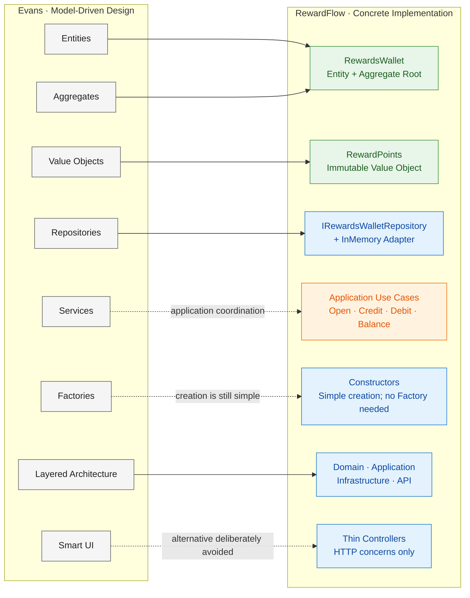

<a id="top"></a>

<div align="center">

# 🏆 RewardFlow.SuppleDesign

### Supple Design, Clean Architecture and Hexagonal Architecture in a practical .NET 8 API

[](https://dotnet.microsoft.com/download/dotnet/8.0)
[](https://learn.microsoft.com/aspnet/core/)
[](#architecture-clean-architecture-and-hexagonal-ports)
[](#how-the-code-applies-evans-supple-design-patterns)
[](https://github.com/rfulgencio3/RewardFlow.SuppleDesign/actions/workflows/ci.yml)
[](#tests)

A runnable loyalty and reward-points API demonstrating the Supple Design patterns from Chapter 10 of Eric Evans' *Domain-Driven Design*.

[Getting started](#run-and-verify) · [Architecture](#architecture-clean-architecture-and-hexagonal-ports) · [Supple Design](#how-the-code-applies-evans-supple-design-patterns) · [API contract](#http-contract-and-errors) · [Contributing](#contributing)

</div>

---

The goal is to make business code easy to read, reason about and change. Small, explicit domain concepts do the business work; application use cases coordinate them; adapters handle HTTP and storage.

> [!NOTE]
> This is an executable teaching project with real validation, concurrency protection and integration tests. It is intentionally smaller than a production loyalty platform.

| At a glance | Choice |
| --- | --- |
| Runtime | .NET 8 and ASP.NET Core Web API |
| Domain | Loyalty wallet and reward points |
| Architecture | Clean Architecture with Hexagonal Ports & Adapters |
| Persistence | In-memory adapter with optimistic concurrency |
| API discovery | Swagger UI and OpenAPI |
| Verification | Domain, application and HTTP integration tests |

## Table of contents

- [Source and further reading](#source-and-further-reading)
- [Educational commentary disclaimer](#educational-commentary-disclaimer)
- [Run and verify](#run-and-verify)
- [Ubiquitous Language and rules](#ubiquitous-language-and-rules)
- [Architecture: Clean Architecture and Hexagonal Ports](#architecture-clean-architecture-and-hexagonal-ports)
- [Project structure](#project-structure)
- [Evans' model building blocks and RewardFlow](#evans-model-building-blocks-and-rewardflow)
- [How the code applies Evans' Supple Design patterns](#how-the-code-applies-evans-supple-design-patterns)
- [HTTP contract and errors](#http-contract-and-errors)
- [Persistence and concurrency](#persistence-and-concurrency)
- [Tests](#tests)
- [Contributing](#contributing)

---

## Source and further reading

This project is inspired by Eric Evans' *Domain-Driven Design: Tackling Complexity in the Heart of Software* (Addison-Wesley, 2003, ISBN `978-0-321-12521-7`).

> [!IMPORTANT]
> The main reference is **Part III, Chapter 10 — “Supple Design.”** It connects deep modeling with code that is clear to use, predictable to change and suitable for continuous refactoring.

| Resource | Use it for |
| --- | --- |
| [Official book page — InformIT](https://www.informit.com/store/domain-driven-design-tackling-complexity-in-the-heart-9780321125217) | Description, publication details and purchase options |
| [Chapter 10: Supple Design — O'Reilly Learning](https://www.oreilly.com/library/view/domain-driven-design-tackling/0321125215/ch10.html) | The chapter catalog and reading page; full access may require a subscription or purchased copy |
| [DDD Reference — Domain Language](https://www.domainlanguage.com/ddd/reference/) | Eric Evans' free companion summary of the book's definitions and patterns |

## Educational commentary disclaimer

> [!NOTE]
> This repository is intentionally more heavily commented than typical production code. The XML documentation names the pattern being demonstrated, explains the design decision and helps readers connect implementation details with the underlying DDD concepts. In a production codebase, comments should usually explain non-obvious intent and trade-offs rather than restate the code.

The central domain types include XML `<seealso>` references that IDEs can present as navigable documentation links:

| Code | Teaching focus | Reference |
| --- | --- | --- |
| [`RewardPoints`](src/RewardFlow.SuppleDesign.Domain/ValueObjects/RewardPoints.cs) | Standalone Class, Closure of Operations and Side-Effect-Free Functions | [Chapter 10: Supple Design](https://www.oreilly.com/library/view/domain-driven-design-tackling/0321125215/ch10.html) |
| [`IRewardsWallet`](src/RewardFlow.SuppleDesign.Domain/Ports/IRewardsWallet.cs) | Intention-Revealing Interfaces | [Chapter 10: Supple Design](https://www.oreilly.com/library/view/domain-driven-design-tackling/0321125215/ch10.html) |
| [`DomainAssertions`](src/RewardFlow.SuppleDesign.Domain/DomainAssertions.cs) | Assertions and explicit invariants | [Chapter 10: Supple Design](https://www.oreilly.com/library/view/domain-driven-design-tackling/0321125215/ch10.html) |
| [`RewardsWallet`](src/RewardFlow.SuppleDesign.Domain/Entities/RewardsWallet.cs) | Conceptual Contours, Entity and Aggregate Root | [DDD Reference](https://www.domainlanguage.com/ddd/reference/) |
| [`IRewardsWalletRepository`](src/RewardFlow.SuppleDesign.Domain/Ports/IRewardsWalletRepository.cs) | Repository as an outbound domain port | [DDD Reference](https://www.domainlanguage.com/ddd/reference/) |

These links are study aids, not claims that this sample is the only valid implementation of Evans' ideas. The design choices are adaptations for a small C# API and should be reconsidered as domain complexity grows.

---

## Run and verify

### Prerequisites

Install a .NET SDK with `.slnx` support (9.0.200 or later) and the ASP.NET Core 8 runtime. The first restore needs access to NuGet for test packages, Swagger tooling and, when necessary, .NET 8 targeting packs. The Domain and Application projects have no third-party package dependencies; the API project uses Swashbuckle for Swagger and OpenAPI.

### Start the API

From the repository root, restore, build, test and run:

```powershell
dotnet restore RewardFlow.SuppleDesign.slnx
dotnet build RewardFlow.SuppleDesign.slnx --no-restore
dotnet test RewardFlow.SuppleDesign.slnx --no-build
dotnet run --project src/RewardFlow.SuppleDesign.Api
```

> [!TIP]
> Open [http://localhost:5180/](http://localhost:5180/) after the API starts. The root redirects to Swagger UI, where every endpoint can be explored and executed. The raw OpenAPI document is available at `/swagger/v1/swagger.json`.

The repository uses the XML-based `.slnx` solution format. No database, credentials or external services are required.

### Try the wallet flow

Visual Studio 2022 17.11 or later also discovers the shared `RewardFlow API` startup profile from [`RewardFlow.SuppleDesign.slnLaunch`](RewardFlow.SuppleDesign.slnLaunch) when the solution is opened.

Open [`RewardFlow.http`](src/RewardFlow.SuppleDesign.Api/RewardFlow.http) in a compatible HTTP client, or expand the PowerShell walkthrough:

<details>
<summary><strong>PowerShell: open, credit, debit and inspect a wallet</strong></summary>

<br />

```powershell
$baseUri = 'http://localhost:5180'
$walletId = [guid]::NewGuid()

# Open the wallet: 201 Created, zero points, Location header for its balance.
Invoke-RestMethod -Method Post -Uri "$baseUri/api/wallets/$walletId"

# Earn 100 points: 200 OK.
Invoke-RestMethod -Method Post -Uri "$baseUri/api/wallets/$walletId/credit" `
    -ContentType 'application/json' -Body '{"points":100}'

# Redeem 40 points: 200 OK, 60 remain.
Invoke-RestMethod -Method Post -Uri "$baseUri/api/wallets/$walletId/debit" `
    -ContentType 'application/json' -Body '{"points":40}'

Invoke-RestMethod -Uri "$baseUri/api/wallets/$walletId/balance"

# Rejected: 422 Unprocessable Entity; balance remains 60.
# PowerShell reports an HTTP error for this intentional failure.
Invoke-RestMethod -Method Post -Uri "$baseUri/api/wallets/$walletId/debit" `
    -ContentType 'application/json' -Body '{"points":61}'
```

</details>

## Ubiquitous Language and rules

| Term | Meaning |
| --- | --- |
| Reward Points | Whole, non-negative units earned and redeemed by a member; represented by `RewardPoints`. |
| Rewards Wallet | Aggregate holding an identified member's available reward points. Member enrollment is outside this example. |
| Open | Create an identified wallet with zero points. |
| Credit | Add earned points to an existing wallet. |
| Debit | Remove redeemed points from an existing wallet. |
| Balance | Reward points currently available to spend. |
| Can Afford | Determine whether the current balance covers required points without changing state. |

Wallet IDs must be non-empty GUIDs. All wallets are opened explicitly; queries and commands never silently create them. A credit or debit must contain at least one point. A balance may be zero, and debiting exactly the balance is valid. An empty wallet cannot fund a positive redemption. `CanAfford(RewardPoints.Zero)` is true, while a zero debit is rejected because a command must move points.

`RewardPoints` uses `long` and accepts values from zero through `long.MaxValue`. Negative construction, subtraction below zero, and addition above the maximum are rejected with domain exceptions. Failed operations leave the original values and wallet balance intact. Record value equality lets two independently constructed equal point amounts compare equal.

## Architecture: Clean Architecture and Hexagonal Ports

```mermaid
flowchart LR
    Client([HTTP Client<br/>Swagger / Integration Tests])

    subgraph Api["API · Primary Adapter"]
        direction TB
        Controller["WalletsController<br/>Routes · Validation · Status Codes"]
        DTOs["Request / Response DTOs<br/>Problem Details"]
        Composition["Program.cs<br/>Composition Root"]
        Controller --- DTOs
    end

    subgraph Application["Application · Use Cases"]
        direction TB
        InboundPorts["Inbound Ports<br/>IOpenRewardsWallet<br/>ICreditRewardPoints<br/>IDebitRewardPoints<br/>IGetWalletBalance<br/>ICheckWalletAffordability"]
        UseCases["Use Case Implementations<br/>Open · Credit · Debit · Balance · Affordability"]
        InboundPorts --> UseCases
    end

    subgraph Domain["Domain · Business Core"]
        direction TB
        WalletPort["IRewardsWallet<br/>Credit · Debit · CanAfford"]
        Wallet["RewardsWallet<br/>Aggregate"]
        Points["RewardPoints<br/>Immutable Value Object"]
        Rules["DomainAssertions<br/>DomainException"]
        RepositoryPort["IRewardsWalletRepository<br/>Outbound Port"]

        WalletPort --> Wallet
        Wallet -->|delegates arithmetic| Points
        Wallet -->|enforces invariants| Rules
        Points -->|validates values| Rules
    end

    subgraph Infrastructure["Infrastructure · Secondary Adapter"]
        Repository["InMemoryRewardsWalletRepository<br/>Detached Snapshots<br/>Optimistic Concurrency"]
    end

    Client -->|HTTP request| Controller
    Controller -->|calls inbound port| InboundPorts
    UseCases -->|invokes domain behavior| WalletPort
    UseCases -->|loads / saves| RepositoryPort
    Repository -.->|implements| RepositoryPort
    Composition -.->|binds ports to adapters| InboundPorts
    Composition -.-> Repository

    classDef external fill:#f5f5f5,stroke:#616161,color:#212121
    classDef adapter fill:#e3f2fd,stroke:#1976d2,color:#0d47a1
    classDef application fill:#fff3e0,stroke:#ef6c00,color:#e65100
    classDef domain fill:#e8f5e9,stroke:#388e3c,color:#1b5e20
    classDef port fill:#f3e5f5,stroke:#7b1fa2,color:#4a148c
    class Client external
    class Controller,DTOs,Composition,Repository adapter
    class UseCases application
    class Wallet,Points,Rules domain
    class InboundPorts,WalletPort,RepositoryPort port
```



The solid arrows show request flow and domain collaboration. The dashed arrows show adapter wiring: `Program.cs` selects implementations, while Infrastructure implements the outbound repository port owned by Domain.

The repository interface is owned by Domain as the requested outbound port. Application owns the inbound use-case interfaces. `IRewardsWallet` is the business behavior contract implemented by the aggregate, rather than a transport or persistence abstraction. The controllers receive the application interfaces through constructor injection.

Domain has no project or package references. Application and Infrastructure reference Domain independently. Infrastructure does not know about HTTP, and Application does not reference Infrastructure. API references Infrastructure only to select the concrete adapter in the composition root. Domain objects are never serialized directly as HTTP contracts.

## Project structure

The folders are architectural boundaries rather than technical buckets. Each project has one direction of responsibility and a deliberately small public surface:

```text
RewardFlow.SuppleDesign/
├── RewardFlow.SuppleDesign.slnx
├── RewardFlow.SuppleDesign.slnLaunch              # Shared Visual Studio startup profile
├── Directory.Build.props                         # Shared .NET 8 build settings
├── README.md
│
├── src/                                           # Production code
│   ├── RewardFlow.SuppleDesign.Domain/            # Business model; no external dependencies
│   │   ├── Entities/
│   │   │   └── RewardsWallet.cs                   # Aggregate root
│   │   ├── ValueObjects/
│   │   │   └── RewardPoints.cs                    # Immutable value object
│   │   ├── Exceptions/
│   │   │   └── DomainException.cs
│   │   ├── Ports/
│   │   │   ├── IRewardsWallet.cs                  # Domain behavior contract
│   │   │   └── IRewardsWalletRepository.cs        # Outbound persistence port
│   │   ├── DomainAssertions.cs                    # Preconditions and invariants
│   │   └── RewardFlow.SuppleDesign.Domain.csproj
│   │
│   ├── RewardFlow.SuppleDesign.Application/       # Use-case orchestration
│   │   ├── Wallets/
│   │   │   ├── Common/                            # Results, exceptions and persistence coordination
│   │   │   ├── OpenWallet/
│   │   │   ├── CreditPoints/
│   │   │   ├── DebitPoints/
│   │   │   ├── GetBalance/
│   │   │   └── CheckAffordability/
│   │   └── RewardFlow.SuppleDesign.Application.csproj
│   │
│   ├── RewardFlow.SuppleDesign.Infrastructure/    # Secondary adapters
│   │   ├── Repositories/
│   │   │   └── InMemoryRewardsWalletRepository.cs
│   │   └── RewardFlow.SuppleDesign.Infrastructure.csproj
│   │
│   └── RewardFlow.SuppleDesign.Api/               # HTTP primary adapter
│       ├── Endpoints/
│       │   └── Wallets/
│       │       └── WalletsController.cs
│       ├── DTOs/
│       │   └── Wallets/
│       │       └── WalletContracts.cs
│       ├── Errors/
│       │   └── ApiExceptionHandler.cs
│       ├── Properties/
│       │   └── launchSettings.json
│       ├── Program.cs                             # Composition root
│       ├── appsettings.json                       # Runtime and port configuration
│       ├── RewardFlow.http                        # Executable HTTP examples
│       └── RewardFlow.SuppleDesign.Api.csproj
│
└── test/                                          # Executable specifications
    └── RewardFlow.SuppleDesign.Tests/
        ├── DomainTests.cs
        ├── ApplicationTests.cs
        ├── WalletApiTests.cs
        └── RewardFlow.SuppleDesign.Tests.csproj
```

| Project | Owns | Depends on |
| --- | --- | --- |
| `RewardFlow.SuppleDesign.Domain` | Ubiquitous Language, invariants, aggregate behavior, value objects and outbound ports | Nothing |
| `RewardFlow.SuppleDesign.Application` | Use-case ports and workflow coordination | Domain |
| `RewardFlow.SuppleDesign.Infrastructure` | Replaceable implementations of outbound ports | Domain |
| `RewardFlow.SuppleDesign.Api` | HTTP endpoints, API contracts, error translation and dependency composition | Application and Infrastructure |
| `RewardFlow.SuppleDesign.Tests` | Executable examples across domain, application and HTTP boundaries | The system under test |

## Evans' model building blocks and RewardFlow

The supplied book figure presents Evans' broader **Model-Driven Design building blocks**. It complements Chapter 10, but it is not itself the Supple Design pattern diagram: Entities, Value Objects, Aggregates, Repositories, Services and Factories are tactical building blocks; Intention-Revealing Interfaces, Side-Effect-Free Functions, Assertions, Conceptual Contours, Standalone Classes and Closure of Operations make that model supple.

The correspondence in this solution is:



| Evans concept | RewardFlow parallel | Interpretation |
| --- | --- | --- |
| Entity | `RewardsWallet` | Has a stable `Guid` identity and behavior that changes its balance. |
| Value Object | `RewardPoints` | Immutable, compared by value, self-validating and closed under `Add` and valid `Subtract` operations. |
| Aggregate | `RewardsWallet` | Serves as the consistency boundary and root for credits, debits and affordability rules. |
| Repository | `IRewardsWalletRepository` | The Domain owns the outbound port; `InMemoryRewardsWalletRepository` is a replaceable Infrastructure adapter. |
| Service | Application use cases | The nearest parallel coordinates workflows. They are application services, not domain services: the business rules remain in `RewardsWallet` and `RewardPoints`. |
| Factory | Constructors | Creation is simple enough to remain in constructors. A dedicated Factory would add ceremony without protecting a new invariant. |
| Layered Architecture | Four projects | Domain is isolated; Application coordinates it; Infrastructure and API are adapters around it. |
| Smart UI | Deliberately absent | Controllers contain HTTP translation only. They do not own reward rules, which prevents the UI from becoming the domain model. |

The original book image can sit immediately above this comparison as `docs/images/evans-model-driven-design.png`. Keep its caption and bibliographic attribution with the image; the Mermaid diagram remains the project-specific interpretation rather than a modified reproduction of the source figure.

## How the code applies Evans' Supple Design patterns

Chapter 10 moves from identifying domain building blocks to shaping code that communicates its purpose. The examples below show where each pattern appears and what design pressure it resolves in RewardFlow.

| Pattern | Code | Why it matters |
| --- | --- | --- |
| Intention-Revealing Interfaces | `IRewardsWallet.Credit`, `Debit`, `CanAfford`; named application ports; repository operations | Readers use the domain's vocabulary instead of generic setters or opaque processing methods. |
| Side-Effect-Free Functions | `RewardsWallet.CanAfford`; `RewardPoints.Add` and `Subtract` | Queries and calculations do not mutate their inputs. Affordability observes the wallet's current balance; arithmetic returns new immutable values. State changes are explicit `Credit` and `Debit` commands. |
| Assertions | `DomainAssertions`, `RewardPoints` construction/overflow protection, aggregate commands | Preconditions and post-state invariants are enforced at runtime rather than left to caller convention or debug-only assertions. HTTP validation supplements these rules; direct domain callers still receive full protection. |
| Conceptual Contours | `RewardPoints`, `RewardsWallet`, use cases, controllers, repository port and adapter | Arithmetic, aggregate state, orchestration, transport, and persistence each have a distinct reason to change. Persistence revision metadata stays outside the aggregate. |
| Standalone Classes | `RewardPoints` | The value object carries its own immutable value, equality, arithmetic, and validity rules. It requires no entity, repository, DI container, ORM, or web framework. Its only collaborators are BCL types and small local domain assertion/exception helpers. |
| Closure of Operations | `RewardPoints.Add(RewardPoints)` and `Subtract(RewardPoints)` | Both operands and successful results remain in the same conceptual set, so expressions compose naturally without unpacking primitives. Operations are partial over non-negative bounded integers: insufficient subtraction or overflow raises an explicit domain exception. |

For example, `new RewardPoints(100).Add(new RewardPoints(25)).Subtract(new RewardPoints(40))` yields 85 points and leaves every operand unchanged. `RewardsWallet.Credit` delegates to that arithmetic and replaces its balance only after validation succeeds. `CanAfford` performs no writes, calls no external service, and has no clock or randomness dependency.

XML comments above public classes, interfaces, and methods identify the relevant patterns. Implementations use `<inheritdoc />` where the interface already describes the behavior. These patterns reinforce one another; the comments explain design intent rather than claim every I/O operation is a pure function.

## HTTP contract and errors

| Method | Route | Request body | Success |
| --- | --- | --- | --- |
| POST | `/api/wallets/{id}` | none | 201 and balance location |
| POST | `/api/wallets/{id}/credit` | `{"points":100}` | 200 and updated balance |
| POST | `/api/wallets/{id}/debit` | `{"points":40}` | 200 and updated balance |
| GET | `/api/wallets/{id}/balance` | none | 200 and current balance |
| GET | `/api/wallets/{id}/can-afford?points=60` | none | 200 and affordability result |

The response body is `{"walletId":"<guid>","points":60}`. IDs in the route must parse as GUIDs; malformed GUID routes do not match and return 404. An all-zero GUID parses but violates a domain invariant and returns 422.

| Status | Situation |
| --- | --- |
| 400 | Invalid JSON, omitted/null points, non-positive points, fractional points, or values outside the `long` range. `[ApiController]` performs contract validation. |
| 404 | A well-formed wallet ID is not found. |
| 409 | Duplicate opening or a stale concurrent write. |
| 422 | Domain rule violation, such as insufficient points, balance overflow, or an empty GUID. |
| 500 | Unexpected failure; the public detail does not expose internal exception information. |

Expected application/domain failures use `application/problem+json` with an additional stable `code`, for example:

```json
{
  "title": "Reward rule violated",
  "status": 422,
  "detail": "The rewards wallet cannot afford the required points.",
  "code": "insufficient_points"
}
```

ASP.NET Core may add standard fields such as `type` or a trace ID. Automatic request validation uses the framework's validation Problem Details with an `errors` collection. Exception-to-HTTP mapping lives exclusively in the API project.

## Persistence and concurrency

The singleton in-memory adapter stores immutable point/revision records. Loading returns a detached aggregate snapshot: mutating it cannot alter stored state until saving succeeds. Opening is atomic. Saving uses an atomic compare-and-swap against the loaded revision, preventing two requests from silently overwriting each other or spending the same snapshot twice. A failed domain operation never reaches persistence.

When two updates race, one can return 409. The client should reload the balance and reconsider/retry the operation. The demo does not automatically retry commands or implement idempotency keys. Repeating a successful credit/debit applies it again. A production adapter could implement the same revision contract with a database concurrency token and a transaction.

> [!WARNING]
> State exists only in the running process and is lost on restart. Separate instances do not share balances.

The sample does not include authentication, authorization, a ledger, member enrollment, reward expiration, durable storage, or transaction-wide integration events. Add those around the explicit business model and ports as requirements evolve. The local HTTP URL is for running the demo; deployment security is outside this example's scope.

## Tests

The xUnit suite covers:

- Value equality, new-value arithmetic, operand immutability, bounds, overdrafts, and overflow.
- Exact-balance redemption, zero-balance protection, empty identity, and rejected mutations preserving state.
- Repeated affordability queries preserving the same balance reference.
- Open/credit/debit/read orchestration, missing-wallet reads, duplicate IDs, cancellation, detached snapshots, and stale-write rejection.
- Real ASP.NET Core routing and DI through `WebApplicationFactory`, response contracts, 201/200/400/404/409/422 behavior, Problem Details, and malformed request bodies.

Every HTTP test uses fresh wallet identities. `dotnet test RewardFlow.SuppleDesign.slnx` builds and executes the suite without starting an external server or needing a database.

## Contributing

RewardFlow.SuppleDesign is a collaborative project. Improvements, constructive criticism and suggestions are always welcome.

To contribute code or documentation:

1. Fork the repository.
2. Create a branch describing the change.
3. Implement the improvement and keep the architectural boundaries explicit.
4. Run `dotnet test RewardFlow.SuppleDesign.slnx`.
5. Open a pull request explaining the motivation, the resulting behavior and how the change was validated.

Contributions can range from typo fixes and clearer examples to new adapters, stronger tests and alternative demonstrations of Supple Design. If you find something confusing or disagree with a design decision, feel free to open a discussion or pull request—the feedback is part of improving the project.

---

<div align="center">

Built as a collaborative study of domain modeling and supple software design.

[Back to top](#top)

</div>
