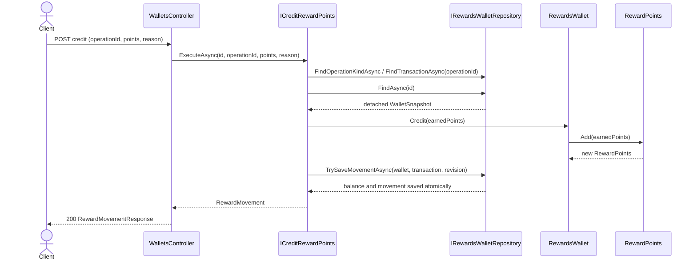
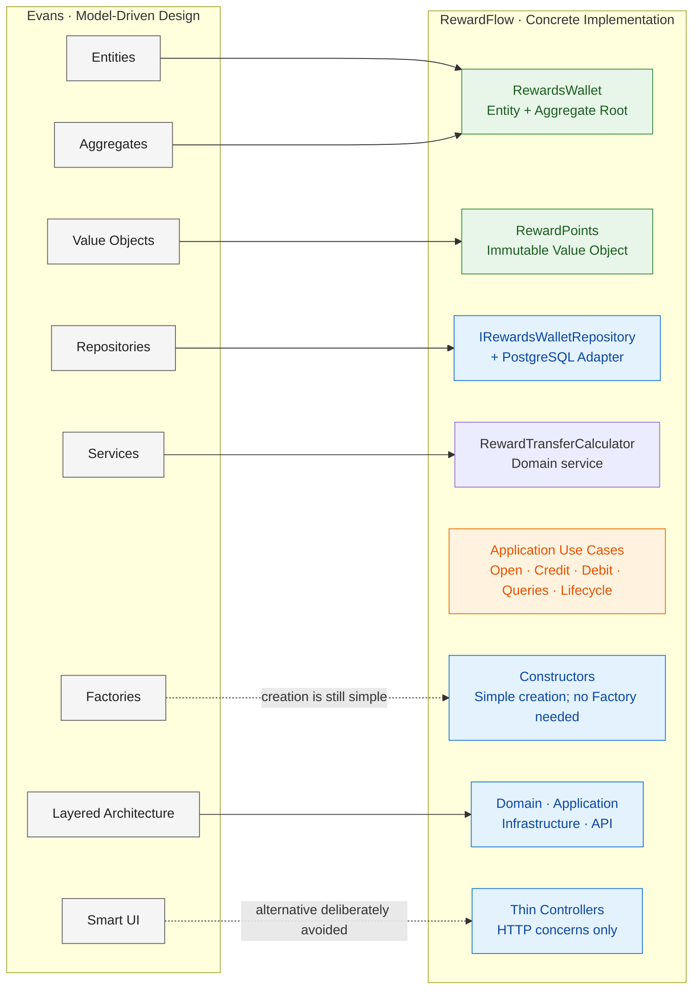
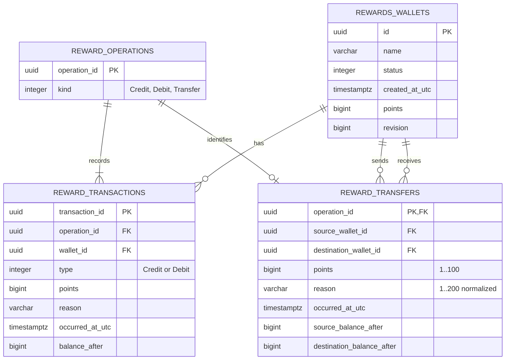

<a id="top"></a>

<div align="center">

**English** · [Português (Brasil)](README.pt-BR.md)

# 🏆 RewardFlow.SuppleDesign

### Supple Design, Clean Architecture and Hexagonal Architecture in a practical .NET 8 API

[](https://dotnet.microsoft.com/download/dotnet/8.0)
[](https://learn.microsoft.com/aspnet/core/)
[](#architecture-clean-architecture-and-hexagonal-ports)
[](#how-the-code-applies-evans-supple-design-patterns)
[](https://github.com/rfulgencio3/RewardFlow.SuppleDesign/actions/workflows/ci.yml)
[](#tests)

A runnable loyalty and reward-points API demonstrating the Supple Design patterns from Chapter 10 of Eric Evans' *Domain-Driven Design*.

[Getting started](#run-and-verify) · [Wallet actions](#how-to-perform-wallet-actions) · [Request flow](#how-a-request-flows-through-the-project) · [Architecture](#architecture-clean-architecture-and-hexagonal-ports) · [Supple Design](#how-the-code-applies-evans-supple-design-patterns) · [Contributing](#contributing)

</div>

---

The goal is to make business code easy to read, reason about and change. Small, explicit domain concepts do the business work; application use cases coordinate them; adapters handle HTTP and storage.

| At a glance | Choice |
| --- | --- |
| Runtime | .NET 8 and ASP.NET Core Web API |
| Domain | Loyalty wallet and reward points |
| Architecture | Clean Architecture with Hexagonal Ports & Adapters |
| Persistence | PostgreSQL 17 through EF Core and Npgsql, with optimistic concurrency |
| API discovery | Swagger UI and OpenAPI |
| Verification | Domain, application and HTTP integration tests |

## Table of contents

- [What is RewardFlow?](#what-is-rewardflow)
- [Supple Design assessment](#supple-design-assessment)
- [Run and verify](#run-and-verify)
- [How to perform wallet actions](#how-to-perform-wallet-actions)
- [Ubiquitous Language and rules](#ubiquitous-language-and-rules)
- [How a request flows through the project](#how-a-request-flows-through-the-project)
- [Architecture: Clean Architecture and Hexagonal Ports](#architecture-clean-architecture-and-hexagonal-ports)
- [Project structure](#project-structure)
- [Evans' model building blocks and RewardFlow](#evans-model-building-blocks-and-rewardflow)
- [How the code applies Evans' Supple Design patterns](#how-the-code-applies-evans-supple-design-patterns)
- [Abstraction budget](#abstraction-budget)
- [Architecture decisions](#architecture-decisions)
- [HTTP contract and errors](#http-contract-and-errors)
- [Persistence and concurrency](#persistence-and-concurrency)
- [Database schema (ERD)](#database-schema-erd)
- [Migrations](#migrations)
- [Tests](#tests)
- [Future educational improvements](#future-educational-improvements)
- [Source and further reading](#source-and-further-reading)
- [Educational commentary disclaimer](#educational-commentary-disclaimer)
- [Contributing](#contributing)
- [Documentation, skills and guardrails](#documentation-skills-and-guardrails)

## What is RewardFlow?

**RewardFlow** is a small loyalty and reward-points management system. Each member is represented by a rewards wallet that can be opened, credited when points are earned, debited when points are redeemed, queried for its current balance, checked to determine whether it can afford a redemption, and used to transfer points to another wallet.

The project focuses on this compact business flow so the domain language and design decisions remain easy to see. Every credit and debit has an identity, reason and immutable audit record. It is an educational model rather than a complete loyalty platform: member enrollment, campaigns, points expiration and authentication remain outside its current scope.

## Supple Design assessment

> [!IMPORTANT]
> **RewardFlow fulfills the purpose of Supple Design within the scope of an educational sample.** Its model speaks the language of rewards, protects invariants where the state lives, keeps queries and calculations predictable, and isolates business decisions from HTTP and persistence.

The flexibility comes from explicit concepts and replaceable boundaries, not from speculative layers. PostgreSQL is implemented as a secondary adapter while EF Core remains outside the Domain and Application projects. The sample omits factories and messaging without a concrete modeling need. Its transfer domain service is justified by a rule involving two wallets. The [pattern mapping](#how-the-code-applies-evans-supple-design-patterns) provides the code-level evidence; the [abstraction budget](#abstraction-budget) explains why each boundary exists and when it should be reconsidered.

---

## Run and verify

### Prerequisites

Install Docker Desktop and the ASP.NET Core 8 runtime. The repository's `global.json` selects the .NET 9 SDK feature band required for `.slnx`; install a compatible .NET 9 SDK if it is not already available. The first restore needs access to NuGet for EF Core, Npgsql, test packages, Swagger tooling and, when necessary, .NET 8 targeting packs. The Domain and Application projects remain free of third-party package dependencies.

### Start the API

From the repository root, restore, build, test and run:

```powershell
docker compose up -d --wait
dotnet restore RewardFlow.SuppleDesign.slnx
dotnet build RewardFlow.SuppleDesign.slnx --no-restore
dotnet test RewardFlow.SuppleDesign.slnx --no-build
dotnet run --project src/RewardFlow.SuppleDesign.Api
```

> [!TIP]
> Open [http://localhost:5180/](http://localhost:5180/) after the API starts. The root redirects to Swagger UI, where every endpoint can be explored and executed. The raw OpenAPI document is available at `/swagger/v1/swagger.json`.

Normal startup suppresses EF Core command noise and reports only the useful stages:

```text
RewardFlow API
[1/3] Preparing application services...
[2/3] Connecting to PostgreSQL and applying migrations...
[OK]  Database is ready.
[3/3] Starting the HTTP server...
[OK]  RewardFlow API is ready.
      Swagger: http://localhost:5180/swagger
      Press Ctrl+C to stop.
```

Compose starts the pinned PostgreSQL image with the local development credentials from `compose.yaml`. The API applies pending EF Core migrations before accepting requests, so the first start creates the schema automatically. Wallets remain available across API restarts because PostgreSQL stores them in the named Docker volume.

## How to perform wallet actions

All routes below are implemented. Transfers move 1..100 points per operation, require sufficient source balance and commit both wallets atomically; see the [implementation guide](docs/transfer-plan.md).

Start the API first, then choose one of these entry points: execute requests in Swagger at [http://localhost:5180/](http://localhost:5180/), open [`RewardFlow.http`](src/RewardFlow.SuppleDesign.Api/RewardFlow.http) in a compatible HTTP client, or use the PowerShell walkthrough below.

Keep each wallet ID for its flow; transfers require two previously opened wallets. Retain an operationId only when retrying the same operation.

| Goal | Request | Input | Expected result |
| --- | --- | --- | --- |
| Open a wallet | `POST /api/wallets` | `{ "name": "Primary rewards" }` | `201 Created`, generated `walletId` and a `Location` header |
| Read wallet details | `GET /api/wallets/{id}` | No body | `200 OK` with name, status, creation time and balance |
| Credit earned points | `POST /api/wallets/{id}/credit` | `{ "operationId": "uuid", "points": 100, "reason": "Purchase" }` | `200 OK` with the movement and resulting balance |
| Debit redeemed points | `POST /api/wallets/{id}/debit` | `{ "operationId": "uuid", "points": 40, "reason": "Redemption" }` | `200 OK`, provided the wallet can afford the amount |
| Transfer points | `POST /api/wallets/{sourceWalletId}/transfers` | `operationId`, `destinationWalletId`, `points` (1..100), `reason` | `200 OK` with both resulting balances; source must have sufficient balance; atomic save |
| Read the balance | `GET /api/wallets/{id}/balance` | No body | `200 OK` with the current points |
| Check affordability | `GET /api/wallets/{id}/can-afford?requiredPoints=60` | Non-negative whole points in the query string | `200 OK` with `canAfford`; the balance is unchanged |
| Read transaction history | `GET /api/wallets/{id}/transactions?page=1&pageSize=20` | A page of 1 to 100 items | `200 OK` in reverse chronological order with `hasNextPage` |
| Suspend / reactivate / close | `POST /api/wallets/{id}/{action}` | No body | `204 No Content` after a valid lifecycle transition |

The commands below create a wallet, credit 100 points, debit 40, confirm that 60 points are affordable demonstrate an overdraft rejection, and transfer 40 points to a second wallet:

<details>
<summary><strong>PowerShell: open, credit, debit, transfer and inspect wallets</strong></summary>

<br />

```powershell
$baseUri = 'http://localhost:5180'
# Open the wallet: the API generates its identity and returns it with 201 Created.
$opened = Invoke-RestMethod -Method Post -Uri "$baseUri/api/wallets" `
    -ContentType 'application/json' -Body '{"name":"Primary rewards"}'
$walletId = $opened.walletId

Invoke-RestMethod -Uri "$baseUri/api/wallets/$walletId"

# Earn 100 points: 200 OK.
Invoke-RestMethod -Method Post -Uri "$baseUri/api/wallets/$walletId/credit" `
    -ContentType 'application/json' `
    -Body (@{ operationId = [guid]::NewGuid(); points = 100; reason = 'Purchase reward' } | ConvertTo-Json)

# Redeem 40 points: 200 OK, 60 remain.
Invoke-RestMethod -Method Post -Uri "$baseUri/api/wallets/$walletId/debit" `
    -ContentType 'application/json' `
    -Body (@{ operationId = [guid]::NewGuid(); points = 40; reason = 'Gift redemption' } | ConvertTo-Json)

Invoke-RestMethod -Uri "$baseUri/api/wallets/$walletId/balance"

# Read-only query: true, and the balance remains 60.
Invoke-RestMethod -Uri "$baseUri/api/wallets/$walletId/can-afford?requiredPoints=60"

# Rejected: 422 Unprocessable Entity; balance remains 60.
# PowerShell reports an HTTP error for this intentional failure.
Invoke-RestMethod -Method Post -Uri "$baseUri/api/wallets/$walletId/debit" `
    -ContentType 'application/json' `
    -Body (@{ operationId = [guid]::NewGuid(); points = 61; reason = 'Overdraft example' } | ConvertTo-Json)

# Open the destination, then transfer 40 points: source=20, destination=40.
$destination = Invoke-RestMethod -Method Post -Uri "$baseUri/api/wallets" `
    -ContentType 'application/json' -Body '{"name":"Transfer destination"}'
$transferOperationId = [guid]::NewGuid()
$transferBody = @{ operationId = $transferOperationId; destinationWalletId = $destination.walletId; points = 40; reason = 'Reward points transfer' } | ConvertTo-Json
Invoke-RestMethod -Method Post -Uri "$baseUri/api/wallets/$walletId/transfers" `
    -ContentType 'application/json' -Body $transferBody

# An identical retry returns the original result without moving more points.
Invoke-RestMethod -Method Post -Uri "$baseUri/api/wallets/$walletId/transfers" `
    -ContentType 'application/json' -Body $transferBody

```

</details>

## Ubiquitous Language and rules

| Term | Meaning |
| --- | --- |
| Reward Points | Whole, non-negative units earned and redeemed by a member; represented by `RewardPoints`. |
| Rewards Wallet | Aggregate holding an identified member's available reward points. Member enrollment is outside this example. |
| Open | Create an identified wallet with zero points. |
| Credit | Increase a wallet's available points. An ordinary credit records earned points; an incoming transfer also creates a credit entry. |
| Debit | Decrease a wallet's available points. An ordinary debit records redeemed points; an outgoing transfer also creates a debit entry. |
| Balance | Reward points currently available to spend. |
| Transfer | Atomically move 1..100 points between distinct wallets, with sufficient source balance and paired ledger evidence. No points are created or destroyed. |
| Source Wallet / Destination Wallet | The wallet providing / receiving the transferred points. |
| Reward Operation | One accepted credit, debit or transfer, identified globally by the caller's operationId. |
| Ledger Entry | Immutable evidence for one wallet: one entry for an ordinary movement, two linked entries for a transfer. transactionId is internal; operationId identifies the business operation. |
| Can Afford | Determine whether the current balance covers required points without changing state. |
| Suspend | Temporarily block redemptions while continuing to accept earned points. |
| Reactivate | Return a suspended wallet to active use. |
| Close | Permanently prevent new credits and redemptions. |

The application generates a non-empty wallet ID and records its UTC creation instant. A trimmed name from 1 to 120 characters is required. New wallets are active with zero points. Suspended wallets accept credits, reject debits and return false for affordability checks; closed wallets reject every new movement and also return false for affordability. A credit or debit must contain at least one point, a non-empty operation ID and a meaningful reason of up to 200 characters. Identical retries return the original movement; reusing an operation ID with different data returns a conflict. Debiting exactly the balance is valid, and a zero debit is rejected because a command must move points.

`RewardPoints` uses `long` and accepts values from zero through `long.MaxValue`. Negative construction, subtraction below zero, and addition above the maximum are rejected with domain exceptions. Failed operations leave the original values and wallet balance intact. Record value equality lets two independently constructed equal point amounts compare equal.

## How a request flows through the project

This diagram shows the credit flow, including the global operation lookup. The two-wallet transfer sequence and rollback branches are in the [transfer implementation](docs/transfer-plan.md#sequence-and-atomicity).

The credit operation shows how the adapters and core collaborate without moving business rules into the controller or repository:



1. `WalletsController` validates and translates the HTTP request, then calls the inbound application port.
2. `CreditRewardPoints` coordinates the use case and asks the outbound repository port for a detached snapshot.
3. `RewardsWallet.Credit` expresses the state change in domain language and delegates immutable arithmetic to `RewardPoints.Add`.
4. The application saves with the loaded revision, so a concurrent update cannot be silently overwritten. Transfers require both revisions and commit both wallets and both ledger entries together; a stale revision returns 409 and rolls back all writes.
5. The use case returns an application result, which the controller converts into an API response DTO.

Debit follows the same command path. Balance and affordability are queries: they load a snapshot but never call `TrySaveAsync`; `CanAfford` does not mutate the aggregate. Known domain and application failures cross back to `ApiExceptionHandler`, which translates them into HTTP Problem Details at the outer boundary.

## Architecture: Clean Architecture and Hexagonal Ports

The diagram below represents the running system. The [transfer architecture](docs/transfer-plan.md#architecture) uses a domain calculator and a specific atomic persistence capability without introducing new architectural layers.

```mermaid
flowchart LR
    Client([HTTP Client<br/>Swagger / Integration Tests])

    subgraph Api["API · Primary Adapter"]
        direction TB
        Controller["WalletsController<br/>Routes · Validation · Status Codes"]
        DTOs["Request / Response DTOs<br/>Problem Details"]
        Composition["Program.cs<br/>Composition Root"]
        Controller --- DTOs
    end

    subgraph Application["Application · Use Cases"]
        direction TB
        InboundPorts["Inbound Ports<br/>IOpenRewardsWallet<br/>ICreditRewardPoints<br/>ITransferRewardPoints<br/>IDebitRewardPoints<br/>IGetWalletBalance<br/>ICheckWalletAffordability"]
        UseCases["Use Case Implementations<br/>Transfer - Open · Credit · Debit · Balance · Affordability"]
        InboundPorts --> UseCases
    end

    subgraph Domain["Domain · Business Core"]
        direction TB
        WalletPort["IRewardsWallet<br/>Credit · Debit · CanAfford"]
        Wallet["RewardsWallet<br/>Aggregate"]
        Points["RewardPoints + WalletName + TransferAmount<br/>Immutable Value Objects"]
        Rules["DomainAssertions<br/>DomainException"]
        RepositoryPort["IRewardsWalletRepository<br/>Outbound Port"]

        Calculator["RewardTransferCalculator<br/>Two-wallet calculation"]
        UseCases --> Calculator
        Calculator --> Wallet
        WalletPort --> Wallet
        Wallet -->|delegates arithmetic| Points
        Wallet -->|enforces invariants| Rules
        Points -->|validates values| Rules
    end

    subgraph Infrastructure["Infrastructure · Secondary Adapter"]
        Repository["PostgresRewardsWalletRepository<br/>Detached Snapshots<br/>Optimistic Concurrency"]
        DbContext["RewardFlowDbContext<br/>EF Core Mapping · Migrations"]
        Repository --> DbContext
    end

    Database[(PostgreSQL 17<br/>Docker Volume)]

    Client -->|HTTP request| Controller
    Controller -->|calls inbound port| InboundPorts
    UseCases -->|invokes domain behavior| WalletPort
    UseCases -->|loads / saves| RepositoryPort
    Repository -.->|implements| RepositoryPort
    DbContext -->|Npgsql| Database
    Composition -.->|binds ports to adapters| InboundPorts
    Composition -.-> Repository

    classDef external fill:#f5f5f5,stroke:#616161,color:#212121
    classDef adapter fill:#e3f2fd,stroke:#1976d2,color:#0d47a1
    classDef application fill:#fff3e0,stroke:#ef6c00,color:#e65100
    classDef domain fill:#e8f5e9,stroke:#388e3c,color:#1b5e20
    classDef port fill:#f3e5f5,stroke:#7b1fa2,color:#4a148c
    class Client,Database external
    class Controller,DTOs,Composition,Repository,DbContext adapter
    class UseCases application
    class Wallet,Points,Rules,Calculator domain
    class InboundPorts,WalletPort,RepositoryPort port
```



The solid arrows show request flow and domain collaboration. The dashed arrows show adapter wiring: `Program.cs` selects implementations, while Infrastructure implements the outbound repository port owned by Domain.

The repository interface is owned by Domain as the requested outbound port. Application owns the inbound use-case interfaces. `IRewardsWallet` is the business behavior contract implemented by the aggregate, rather than a transport or persistence abstraction. The controllers receive the application interfaces through constructor injection.

Domain has no project or package references. Application and Infrastructure reference Domain independently. Infrastructure does not know about HTTP, and Application does not reference Infrastructure. API references Infrastructure only to select the concrete adapter in the composition root. Domain objects are never serialized directly as HTTP contracts.

## Project structure

Transfer code is included below; the [implementation guide](docs/transfer-plan.md#implementation-sequence-and-acceptance-criteria) maps each layer to its verification evidence.

The folders are architectural boundaries rather than technical buckets. Each project has one direction of responsibility and a deliberately small public surface:

```text
RewardFlow.SuppleDesign/
├── RewardFlow.SuppleDesign.slnx
├── RewardFlow.SuppleDesign.slnLaunch              # Optional shared startup profile
├── Directory.Build.props                         # Shared .NET 8 build settings
├── global.json                                   # Reproducible SDK feature band
├── compose.yaml                                  # Local PostgreSQL 17 container and volume
├── dotnet-tools.json                             # Reproducible EF Core CLI version
├── docs/decisions/                               # Architectural decision records
├── README.md
│
├── src/                                           # Production code
│   ├── RewardFlow.SuppleDesign.Domain/            # Business model; no external dependencies
│   │   ├── Entities/
│   │   │   ├── RewardsWallet.cs                   # Aggregate root and lifecycle rules
│   │   │   ├── RewardsWalletStatus.cs
│   │   │   ├── RewardTransfer.cs                  # Original paired-operation result
│   │   │   └── RewardTransaction.cs               # Identified immutable movement
│   │   ├── Services/RewardTransferCalculator.cs     # Calculation without mutation
│   │   ├── ValueObjects/
│   │   │   ├── TransferAmount.cs                  # Transfer-specific 1..100 rule
│   │   │   ├── RewardPoints.cs                    # Immutable arithmetic value object
│   │   │   ├── WalletName.cs                      # Normalized name value object
│   │   │   └── RewardReason.cs                    # Normalized movement reason
│   │   ├── Exceptions/
│   │   │   └── DomainException.cs
│   │   ├── Ports/
│   │   │   ├── IRewardsWallet.cs                  # Domain behavior contract
│   │   │   └── IRewardsWalletRepository.cs        # Outbound persistence port
│   │   ├── DomainAssertions.cs                    # Preconditions and invariants
│   │   └── RewardFlow.SuppleDesign.Domain.csproj
│   │
│   ├── RewardFlow.SuppleDesign.Application/       # Use-case orchestration
│   │   ├── Wallets/
│   │   │   ├── Common/                            # Results, exceptions and persistence coordination
│   │   │   ├── OpenWallet/
│   │   │   ├── TransferPoints/TransferRewardPoints.cs
│   │   │   ├── CreditPoints/
│   │   │   ├── DebitPoints/
│   │   │   ├── ChangeStatus/
│   │   │   ├── GetWallet/
│   │   │   ├── GetBalance/
│   │   │   └── CheckAffordability/
│   │   └── RewardFlow.SuppleDesign.Application.csproj
│   │
│   ├── RewardFlow.SuppleDesign.Infrastructure/    # Secondary adapters
│   │   ├── Persistence/
│   │   │   ├── Configurations/                    # Fluent EF Core mapping
│   │   │   ├── Migrations/                        # Versioned PostgreSQL schema
│   │   │   ├── Models/                            # Persistence-only records
│   │   │   ├── RewardFlowDbContext.cs
│   │   │   └── RewardFlowDbContextFactory.cs      # Migration tooling
│   │   ├── Repositories/
│   │   │   └── PostgresRewardsWalletRepository.cs
│   │   ├── DependencyInjection.cs                 # Adapter registration and migration startup
│   │   └── RewardFlow.SuppleDesign.Infrastructure.csproj
│   │
│   └── RewardFlow.SuppleDesign.Api/               # HTTP primary adapter
│       ├── Endpoints/
│       │   └── Wallets/
│       │       └── WalletsController.cs
│       ├── DTOs/
│       │   └── Wallets/
│       │       ├── WalletContracts.cs
│       │       └── WalletContractExamples.cs
│       ├── Errors/
│       │   └── ApiExceptionHandler.cs
│       ├── Properties/
│       │   └── launchSettings.json
│       ├── Program.cs                             # Composition root
│       ├── appsettings.json                       # Connection string and runtime configuration
│       ├── RewardFlow.http                        # Executable HTTP examples
│       └── RewardFlow.SuppleDesign.Api.csproj
│
└── test/                                          # Executable specifications
    └── RewardFlow.SuppleDesign.Tests/
        ├── TestDoubles/
        │   └── InMemoryRewardsWalletRepository.cs
        ├── TransferDomainTests.cs
        ├── TransferApplicationTests.cs
        ├── TransferPostgresTests.cs
        ├── TransferApiTests.cs
        ├── TransferMigrationTests.cs
        ├── DomainTests.cs
        ├── ApplicationTests.cs
        ├── PostgresRepositoryTests.cs
        ├── WalletApiTests.cs
        └── RewardFlow.SuppleDesign.Tests.csproj
```

| Project | Owns | Depends on |
| --- | --- | --- |
| `RewardFlow.SuppleDesign.Domain` | Ubiquitous Language, invariants, aggregate behavior, value objects and outbound ports | Nothing |
| `RewardFlow.SuppleDesign.Application` | Use-case ports and workflow coordination | Domain |
| `RewardFlow.SuppleDesign.Infrastructure` | Replaceable implementations of outbound ports | Domain |
| `RewardFlow.SuppleDesign.Api` | HTTP endpoints, API contracts, error translation and dependency composition | Application and Infrastructure |
| `RewardFlow.SuppleDesign.Tests` | Executable examples across domain, application and HTTP boundaries | The system under test |

## Evans' model building blocks and RewardFlow

The diagram includes a domain service for the calculation involving two wallets; application orchestration remains separate. See [ADR-003](docs/decisions/003-atomic-wallet-transfers.md).

The supplied book figure presents Evans' broader **Model-Driven Design building blocks**. It complements Chapter 10, but it is not itself the Supple Design pattern diagram: Entities, Value Objects, Aggregates, Repositories, Services and Factories are tactical building blocks; Intention-Revealing Interfaces, Side-Effect-Free Functions, Assertions, Conceptual Contours, Standalone Classes and Closure of Operations make that model supple.

The correspondence in this solution is:



| Evans concept | RewardFlow parallel | Interpretation |
| --- | --- | --- |
| Entity | `RewardsWallet` | Has a stable `Guid` identity and behavior that changes its balance. |
| Value Object | `RewardPoints` and `WalletName` | Immutable, compared by value and self-validating; point arithmetic is closed under `Add` and valid `Subtract` operations. |
| Aggregate | `RewardsWallet` | Serves as the consistency boundary and root for credits, debits and affordability rules. |
| Repository | `IRewardsWalletRepository` | The Domain owns the outbound port; `PostgresRewardsWalletRepository` is an Infrastructure adapter, while tests use an in-memory double. |
| Service | RewardTransferCalculator | Domain service relates two wallets using their side-effect-free balance previews. Application use cases coordinate I/O separately. |
| Factory | Constructors | Creation is simple enough to remain in constructors. A dedicated Factory would add ceremony without protecting a new invariant. |
| Layered Architecture | Four projects | Domain is isolated; Application coordinates it; Infrastructure and API are adapters around it. |
| Smart UI | Deliberately absent | Controllers contain HTTP translation only. They do not own reward rules, which prevents the UI from becoming the domain model. |

The Mermaid diagram is a project-specific interpretation of the model-building blocks described by Evans; it is not a reproduction of a figure from the book. The bibliographic links in [Source and further reading](#source-and-further-reading) point readers to the original material.

## How the code applies Evans' Supple Design patterns

Chapter 10 moves from identifying domain building blocks to shaping code that communicates its purpose. The examples below show where each pattern appears and what design pressure it resolves in RewardFlow.

| Pattern | Code | Why it matters |
| --- | --- | --- |
| Intention-Revealing Interfaces | `Credit`, `Debit`, `CanAfford`, `Suspend`, `Reactivate`, `Close`; named application ports | Readers use the domain's vocabulary instead of generic setters or opaque processing methods. |
| Side-Effect-Free Functions | `RewardTransferCalculator.Calculate`, balance previews; `RewardsWallet.CanAfford`; `RewardPoints.Add` and `Subtract` | Queries and calculations do not mutate their inputs. Affordability observes the wallet's current balance; arithmetic returns new immutable values. State changes are explicit `Credit` and `Debit` commands. |
| Assertions | `TransferAmount`, `DomainAssertions`, value-object construction, point limits and lifecycle transitions | Preconditions and post-state invariants are enforced at runtime rather than left to caller convention or debug-only assertions. HTTP validation supplements these rules; direct domain callers still receive full protection. |
| Conceptual Contours | `RewardPoints`, `RewardsWallet`, use cases, controllers, repository port and adapter | Arithmetic, aggregate state, orchestration, transport, and persistence each have a distinct reason to change. Persistence revision metadata stays outside the aggregate. |
| Standalone Classes | `TransferAmount`, `RewardPoints` and `WalletName` | Each value object carries its immutable value and validity rules without requiring a repository, DI container, ORM or web framework. |
| Closure of Operations | `RewardPoints.Add(RewardPoints)` and `Subtract(RewardPoints)` | Both operands and successful results remain in the same conceptual set, so expressions compose naturally without unpacking primitives. Operations are partial over non-negative bounded integers: insufficient subtraction or overflow raises an explicit domain exception. |

For example, `new RewardPoints(100).Add(new RewardPoints(25)).Subtract(new RewardPoints(40))` yields 85 points and leaves every operand unchanged. `RewardsWallet.Credit` delegates to that arithmetic and replaces its balance only after validation succeeds. `CanAfford` performs no writes, calls no external service, and has no clock or randomness dependency.

XML comments above public classes, interfaces, and methods identify the relevant patterns. Implementations use `<inheritdoc />` where the interface already describes the behavior. These patterns reinforce one another; the comments explain design intent rather than claim every I/O operation is a pure function.

## Abstraction budget

Transfer abstractions have concrete responsibilities: `TransferAmount` owns the 1..100 limit, `RewardTransferCalculator` computes both results without mutation, and transfer evidence records the paired operation. The operation registry separates idempotency from ledger entry identity. Their justification and alternatives are recorded in the [implementation guide](docs/transfer-plan.md).

Supple Design favors code that exposes the model with the least machinery needed to protect it. Every abstraction in this sample therefore needs a current reason to exist and a clear condition under which it should be reconsidered.

| Abstraction | Why it exists now | Reconsider it when |
| --- | --- | --- |
| `RewardPoints` | Gives point arithmetic, range checks and value equality one domain home instead of scattering primitive `long` operations. | Points no longer have behavior or invariants beyond the primitive value. |
| `WalletName` | Owns normalization, required text and length instead of repeating string rules across adapters. | Wallet names stop carrying a domain rule beyond raw text. |
| `RewardsWallet` | Defines the consistency boundary for identity, balance and credit/debit behavior. | Wallet behavior separates into independently consistent concepts. |
| `IRewardsWallet` | Names the small domain role required to demonstrate an intention-revealing interface. It is not presented as a persistence or DI seam, and `RewardsWallet` is its only implementation. | The teaching goal no longer needs the explicit role contract, or a real second domain implementation changes its shape. |
| `DomainAssertions` | Shares domain assertions used across `RewardPoints` and `RewardsWallet` while preserving domain-specific error codes. | A rule belongs to only one type; move it beside that state instead of growing a generic validation utility. |
| Application use-case interfaces | Act as inbound ports so the HTTP controller depends on capabilities such as crediting and checking affordability, not concrete orchestration. | The application is no longer consumed through an adapter boundary, or several ports acquire identical semantics and can be combined without losing language. |
| `WalletBalance` and `WalletAffordability` | Return application results without coupling use cases to HTTP DTOs or exposing mutable aggregates. | A result has exactly one consumer and no boundary-specific representation to isolate. |
| `IRewardsWalletRepository` | Is the outbound persistence port; PostgreSQL and the test double satisfy the same application contract. | Storage is no longer replaceable or persistence behavior becomes part of a different consistency boundary. |
| `WalletSnapshot` and revision checks | Prevent concurrent commands from silently overwriting a balance loaded from an older revision. | The chosen store supplies an equivalent concurrency contract through a simpler port. |
| `WalletPersistence` | Centralizes the repeated not-found and optimistic-save coordination shared by several use cases. | Only one caller remains or the shared workflow begins hiding different business decisions. |
| `RewardFlowDbContext` and persistence models | Translate between relational storage and detached aggregates without adding EF Core annotations or tracking behavior to the Domain. | A different adapter replaces EF Core, or a mapping becomes simple enough to live entirely inside its repository. |
| API DTOs and `ApiExceptionHandler` | Keep validation, serialization, status codes and Problem Details at the HTTP boundary. | The primary adapter changes; replace these contracts rather than leaking HTTP into the core. |

The project deliberately has no generic repository, Unit of Work wrapper, mediator, mapping framework, factory or event bus. RewardTransferCalculator is a domain service justified by a concrete two-wallet rule. Those omitted mechanisms currently protect no additional invariant or adapter boundary. A new layer or interface should be introduced only when a concrete requirement creates that boundary; a pattern name alone is not sufficient justification.

## Architecture decisions

Decisions whose trade-offs span several classes are recorded in [`docs/decisions`](docs/decisions/README.md). The current records explain why transaction history stays outside wallet reconstitution, how `operationId` provides idempotency, why balance and ledger records commit atomically, and why this educational API applies migrations during startup.

The records preserve the reasoning so readers can distinguish a deliberate conceptual boundary from incidental implementation structure.

## HTTP contract and errors

This table lists implemented routes. The `POST /api/wallets/{sourceWalletId}/transfers` contract, request/response examples and errors are in the [plan](docs/transfer-plan.md#http-contract).

| Method | Route | Request body | Success |
| --- | --- | --- | --- |
| POST | `/api/wallets` | `{"name":"Primary rewards"}` | 201, generated ID and wallet location |
| GET | `/api/wallets/{id}` | none | 200 and wallet details |
| POST | `/api/wallets/{id}/credit` | operation ID, points and reason | 200 and accepted movement |
| POST | `/api/wallets/{id}/debit` | operation ID, points and reason | 200 and accepted movement |
| POST | `/api/wallets/{sourceWalletId}/transfers` | operationId, destinationWalletId, points (1..100), reason | 200 with the original transfer result |
| GET | `/api/wallets/{id}/transactions?page=1&pageSize=20` | No body | 200 and a ledger page |
| GET | `/api/wallets/{id}/balance` | none | 200 and current balance |
| GET | `/api/wallets/{id}/can-afford?requiredPoints=60` | none | 200 and affordability result |
| POST | `/api/wallets/{id}/suspend` | none | 204 after suspension |
| POST | `/api/wallets/{id}/reactivate` | none | 204 after reactivation |
| POST | `/api/wallets/{id}/close` | none | 204 after permanent closure |

Creation returns only `{"walletId":"<guid>"}`; its `Location` header addresses the new wallet. The balance query returns `{"points":60}`. Credit and debit return the accepted movement, including `operationId`, `type`, `points`, `reason`, `occurredAtUtc` and `balanceAfter`. IDs in routes must parse as GUIDs; malformed GUID routes do not match and return 404. An all-zero GUID parses but violates a domain invariant and returns 422.

| Status | Situation |
| --- | --- |
| 400 | Invalid JSON, a missing/blank/oversized name, or omitted, non-positive, fractional or out-of-range points. `[ApiController]` performs contract validation. |
| 404 | A well-formed wallet ID is not found. |
| 409 | Stale concurrent write or a command incompatible with the wallet's current status. |
| 422 | Domain rule violation, such as insufficient points, balance overflow, or an empty GUID. |
| 500 | Unexpected failure; the public detail does not expose internal exception information. |

Expected application/domain failures use `application/problem+json` with an additional stable `code`, for example:

```json
{
  "title": "Reward rule violated",
  "status": 422,
  "detail": "The rewards wallet cannot afford the required points.",
  "code": "insufficient_points"
}
```

ASP.NET Core may add standard fields such as `type` or a trace ID. Automatic request validation uses the framework's validation Problem Details with an `errors` collection. Exception-to-HTTP mapping lives exclusively in the API project.

## Persistence and concurrency

`PostgresRewardsWalletRepository` implements the domain-owned repository port through EF Core and Npgsql. The adapter maps a persistence-only `RewardsWalletState` to a fresh `RewardsWallet` and immutable `RewardPoints` on every load. The aggregate has no EF Core attributes, proxy requirements, navigation properties or persistence constructor.

Opening inserts revision `0`; PostgreSQL's primary key protects the generated identity. An accepted movement updates the balance by expected revision and inserts its immutable transaction record in one database transaction. The `reward_operations.operation_id` key prevents duplicate operations while the revision prevents lost updates. An identical retry returns the original result; different data for the same identity returns 409. A rejected domain operation performs no writes. Transfers check both revisions in one transaction; optimistic concurrency does not eliminate PostgreSQL's normal write locks.

The connection string is read from `ConnectionStrings:RewardFlow`. Local settings match `compose.yaml`; deployments can override it with the `ConnectionStrings__RewardFlow` environment variable. The checked-in password is only a local development credential.

### Database schema (ERD)

The implemented schema includes `reward_operations`, `reward_transfers` and an independent ledger `transaction_id`, allowing two entries for one operation while preserving existing operation IDs.

The schema separates current wallet state from its immutable ledger. `WalletName`, `RewardReason` and `RewardPoints` are flattened value objects, while `revision` belongs to persistence coordination rather than to the aggregate.



Check constraints reject blank names, unsupported status values, negative points and negative revisions.

### Migrations

**Implemented:** `20261024215631_AddWalletTransfers`. The [migration plan](docs/transfer-plan.md#migration-addwallettransfers) specifies backfill, key/FK changes, constraints, old endpoint compatibility, upgrade tests, rollback restrictions and rollout. The migration, designer and updated snapshot are versioned. Backfill retains old operation IDs; downgrade is refused while transfer operations exist. Stop old API writers before upgrading.

The schema migrations are versioned under `Infrastructure/Persistence/Migrations`, including the incremental wallet-profile and lifecycle change. `Program.cs` calls `ApplyRewardFlowMigrationsAsync` before middleware is activated, and that adapter helper invokes `Database.MigrateAsync`.

To create a migration after changing only the persistence mapping:

```powershell
dotnet tool restore
dotnet tool run dotnet-ef migrations add DescribeTheSchemaChange `
    --project src/RewardFlow.SuppleDesign.Infrastructure/RewardFlow.SuppleDesign.Infrastructure.csproj `
    --output-dir Persistence/Migrations
```

> [!CAUTION]
> Runtime migration is intentional for this self-contained educational project. For production, inspect migrations and prefer a reviewed SQL script or migration bundle executed by the deployment process with dedicated schema permissions. The application identity should normally have only data read/write permissions.

Useful local database commands:

```powershell
# Stop containers and retain wallet data.
docker compose down

# Delete the local database volume and start from an empty database.
docker compose down --volumes
```

## Tests

The Release suite passes 70 tests. [Transfer verification](docs/transfer-plan.md#implementation-sequence-and-acceptance-criteria) covers domain rules, HTTP, two-wallet revision checks, competing/opposite transfers, injected rollback and migration preservation. It does not claim every possible interleaving is covered.

The xUnit suite covers:

- Value equality, new-value arithmetic, operand immutability, bounds, overdrafts, and overflow.
- Wallet-name normalization, generated identity, UTC creation time and lifecycle transitions.
- Exact-balance redemption, zero-balance protection, empty identity, and rejected mutations preserving state.
- Repeated affordability queries preserving the same balance reference.
- Open/credit/debit/read orchestration, missing-wallet reads, duplicate IDs, cancellation, detached snapshots, and stale-write rejection.
- Concurrent retries converging on one operation; transfer rollback after injected failures following actual balance and ledger writes.
- Ledger pagination and `hasNextPage`. The implementation fetches one extra item instead of issuing a count query; the suite verifies pagination results rather than SQL query counts.
- PostgreSQL mapping, startup migration and conditional revision updates through the real adapter. Persistence across API restarts follows from PostgreSQL storage; the suite does not include a dedicated restart test.
- Real ASP.NET Core routing and DI through `WebApplicationFactory`, response contracts, 201/200/400/404/409/422 behavior, Problem Details, and malformed request bodies.
- Meaningful Swagger examples that remain independent from HTTP validation implementation.

Database tests use fresh wallet identities. The migration test creates and drops its own temporary database, so the configured test user needs CREATEDB permission (provided by the local Compose user). Start PostgreSQL with `docker compose up -d --wait`; `dotnet test RewardFlow.SuppleDesign.slnx` then builds the solution, applies pending migrations and executes the suite without starting an external HTTP server. Application tests use the in-memory repository only as a fast test double for the same port semantics.

## Future educational improvements

Future additions should introduce a concrete modeling pressure and make its effect on the design visible. The purpose is to deepen the Supple Design example without turning the repository into a catalog of infrastructure patterns.

| Learning increment | Domain question to explore | Supple Design focus |
| --- | --- | --- |
| Points expiration | How should points earned at different times expire while preserving valid redemption rules? | Introduce explicit temporal concepts, Intention-Revealing Interfaces and Assertions instead of spreading date comparisons across use cases. |
| Configurable earning policy | How are purchase amount, campaign and membership tier converted into points? | Model the calculation as a Standalone Class with a Side-Effect-Free Function whose inputs and result are explicit. |
| Algebraic and property-based examples | Which properties always hold for reward-point operations? | Demonstrate Closure of Operations, immutability and invariants with properties such as additive identity and rejected underflow. |

Each increment should begin with examples, vocabulary and failing tests. Only then should the model change. The README and abstraction budget should be updated with the new decision, alternatives considered and the condition that justifies every new type or boundary.

## Source and further reading

This project is inspired by Eric Evans' *Domain-Driven Design: Tackling Complexity in the Heart of Software* (Addison-Wesley, 2003, ISBN `978-0-321-12521-7`).

> [!IMPORTANT]
> The main reference is **Part III, Chapter 10 — “Supple Design.”** It connects deep modeling with code that is clear to use, predictable to change and suitable for continuous refactoring.

| Resource | Use it for |
| --- | --- |
| [Official book page — InformIT](https://www.informit.com/store/domain-driven-design-tackling-complexity-in-the-heart-9780321125217) | Description, publication details and purchase options |
| [Chapter 10: Supple Design — O'Reilly Learning](https://www.oreilly.com/library/view/domain-driven-design-tackling/0321125215/ch10.html) | The chapter catalog and reading page; full access may require a subscription or purchased copy |
| [DDD Reference — Domain Language](https://www.domainlanguage.com/ddd/reference/) | Eric Evans' free companion summary of the book's definitions and patterns |
| [Npgsql EF Core provider](https://www.npgsql.org/efcore/) | PostgreSQL provider configuration and EF Core integration |
| [Applying EF Core migrations](https://learn.microsoft.com/ef/core/managing-schemas/migrations/applying) | Migration deployment strategies and runtime-migration trade-offs |

## Educational commentary disclaimer

> [!NOTE]
> This repository is intentionally more heavily commented than typical production code. The XML documentation names the pattern being demonstrated, explains the design decision and helps readers connect implementation details with the underlying DDD concepts. In a production codebase, comments should usually explain non-obvious intent and trade-offs rather than restate the code.

The central domain types include XML `<seealso>` references that IDEs can present as navigable documentation links:

| Code | Teaching focus | Reference |
| --- | --- | --- |
| [`RewardPoints`](src/RewardFlow.SuppleDesign.Domain/ValueObjects/RewardPoints.cs) | Standalone Class, Closure of Operations and Side-Effect-Free Functions | [Chapter 10: Supple Design](https://www.oreilly.com/library/view/domain-driven-design-tackling/0321125215/ch10.html) |
| [`WalletName`](src/RewardFlow.SuppleDesign.Domain/ValueObjects/WalletName.cs) | Standalone Class and Assertions | [Chapter 10: Supple Design](https://www.oreilly.com/library/view/domain-driven-design-tackling/0321125215/ch10.html) |
| [`RewardReason`](src/RewardFlow.SuppleDesign.Domain/ValueObjects/RewardReason.cs) | Standalone Class and explicit language for a movement's reason | [Chapter 10: Supple Design](https://www.oreilly.com/library/view/domain-driven-design-tackling/0321125215/ch10.html) |
| [`RewardTransaction`](src/RewardFlow.SuppleDesign.Domain/Entities/RewardTransaction.cs) | Entity and new Conceptual Contour for audit and idempotency | [DDD Reference](https://www.domainlanguage.com/ddd/reference/) |
| [`IRewardsWallet`](src/RewardFlow.SuppleDesign.Domain/Ports/IRewardsWallet.cs) | Intention-Revealing Interfaces | [Chapter 10: Supple Design](https://www.oreilly.com/library/view/domain-driven-design-tackling/0321125215/ch10.html) |
| [`DomainAssertions`](src/RewardFlow.SuppleDesign.Domain/DomainAssertions.cs) | Assertions and explicit invariants | [Chapter 10: Supple Design](https://www.oreilly.com/library/view/domain-driven-design-tackling/0321125215/ch10.html) |
| [`RewardsWallet`](src/RewardFlow.SuppleDesign.Domain/Entities/RewardsWallet.cs) | Conceptual Contours, Entity and Aggregate Root | [DDD Reference](https://www.domainlanguage.com/ddd/reference/) |
| [`IRewardsWalletRepository`](src/RewardFlow.SuppleDesign.Domain/Ports/IRewardsWalletRepository.cs) | Repository as an outbound domain port | [DDD Reference](https://www.domainlanguage.com/ddd/reference/) |

These links are study aids, not claims that this sample is the only valid implementation of Evans' ideas. The design choices are adaptations for a small C# API and should be reconsidered as domain complexity grows.

## Contributing

Read the [guardrails](docs/guardrails.md) before changing behavior. Keep source code, identifiers and code comments in English. Keep shared claims in both README translations aligned. Use a new globally unique `operationId` for each new movement, including when repeating the `.http` walkthrough with another wallet; retain that ID only when retrying the same operation.

RewardFlow.SuppleDesign is a collaborative project. Improvements, constructive criticism and suggestions are always welcome.

To contribute code or documentation:

1. Fork the repository.
2. Create a branch describing the change.
3. Implement the improvement and keep the architectural boundaries explicit.
4. Run `dotnet test RewardFlow.SuppleDesign.slnx`.
5. Open a pull request explaining the motivation, the resulting behavior and how the change was validated.

Contributions can range from typo fixes and clearer examples to new adapters, stronger tests and alternative demonstrations of Supple Design. If you find something confusing or disagree with a design decision, feel free to open a discussion or pull request—the feedback is part of improving the project.

## Documentation, skills and guardrails

The primary goal is an objective, educational implementation of Eric Evans' Supple Design patterns. Start with the [documentation index](docs/README.md), [pattern guide](docs/supple-design.md), [project analysis](docs/project-analysis.md) and [guardrails](docs/guardrails.md). English is the canonical language of documentation, plans, ADRs, skills, diagrams, code and comments, as required by the [constitution](docs/constitution.md). README.pt-BR.md is the explicit Portuguese translation exception. The sample demonstrates six patterns; it does not claim complete coverage of Chapter 10, including declarative design. Intention-Revealing Interfaces concerns meaningful public contracts and does not require a C# interface for every type.

| Resource | Role |
| --- | --- |
| [AGENTS.md](AGENTS.md) | Repository instructions and essential guardrails for compatible coding agents |
| [rewardflow-evolve](.agents/skills/rewardflow-evolve/SKILL.md) | Workflow for evolving domain rules, value objects and use cases |
| [rewardflow-review](.agents/skills/rewardflow-review/SKILL.md) | Workflow for reviewing correctness and educational explanations |
| [Guardrails](docs/guardrails.md) | Shared review criteria for contributors and agents |
| [CI](.github/workflows/ci.yml) | Automated restore, Release build and tests with PostgreSQL |

In Codex, repository instructions are discovered through `AGENTS.md`; skills under `.agents/skills/` can be selected automatically by their descriptions or invoked explicitly with `$rewardflow-evolve` and `$rewardflow-review`. You do not normally need to announce their existence in every prompt. Discovery depends on the tool and its configuration; when a skill is unavailable, ask the agent to read its linked `SKILL.md` directly. See the official OpenAI documentation for [AGENTS.md](https://developers.openai.com/codex/guides/agents-md) and [skills](https://developers.openai.com/codex/skills).

People should read these instructions when contributing; other tools may require configuration or explicit context. Instructions guide changes, while tests and CI verify only the checks they implement. Educational clarity and conceptual accuracy still require review. Skills do not grant permission to publish or perform unrelated external actions.

---

<div align="center">

Built as a collaborative study of domain modeling and supple software design.

[Back to top](#top)

</div>
