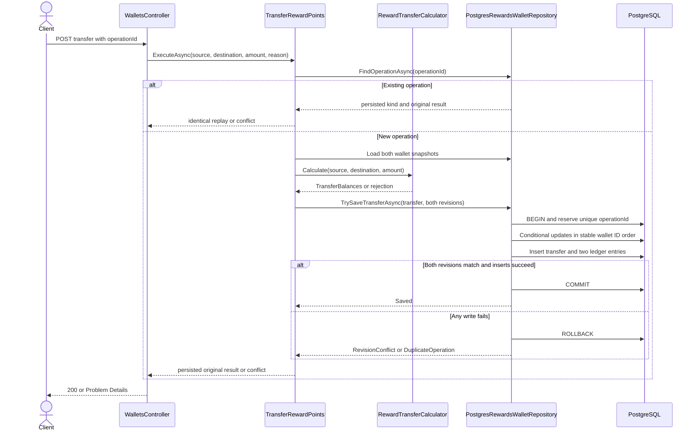
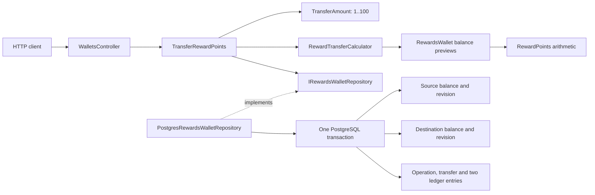
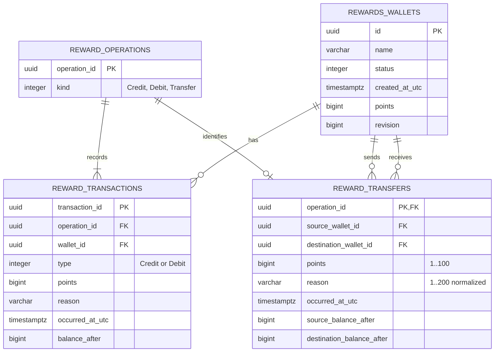

# Wallet transfer implementation plan

Status: **proposed, not implemented**. This delivery covers planning/documentation only. The endpoint, types, transfer tests and migration described here do not exist yet. Follow the English-language [constitution](constitution.md).

## Rules and examples

Interpret the requested limit as **100 points per transfer**, inclusive, with no daily/cumulative quota or fee. These are explicit planning assumptions. Source and destination must exist, have nonempty IDs and be distinct. Transfer whole points from 1 through 100. Source must have sufficient balance; spending exactly its balance is valid.

Preserve current lifecycle semantics: source must be active; destination may be active or suspended because suspension permits credits. A closed destination rejects new transfers. Destination overflow rejects everything. This is a local policy proposal, not an Evans requirement.

| Initial state | Request | Outcome |
| --- | --- | --- |
| A=150, B=20 | 100 | A=50, B=120 |
| A=100, B=0 | 100 | A=0, B=100 |
| A=500, B=0 | 101 | Limit rejection; both unchanged |
| A=99, B=20 | 100 | Insufficient balance; both unchanged |
| A=150, B=20 | 0 or negative | Rejected; both unchanged |
| A=150, B=long.MaxValue | 1 | Overflow; both unchanged |
| Suspended A or closed B | 1 | State conflict; both unchanged |
| A=150, suspended B=20 | 10 | A=140, B=30 |
| Same wallet at both ends | 10 | Rejected even if funded |

Conservation: sourceAfter = sourceBefore - points; destinationAfter = destinationBefore + points. Tests must avoid overflowing a sum of two long values: compare deltas or use BigInteger.

## Domain model and Supple Design

| Proposed concept | Responsibility and justification |
| --- | --- |
| TransferAmount | Immutable value containing RewardPoints; enforces 1..100 with MaximumPoints=100. Ordinary RewardPoints/credit/debit remain valid above 100 |
| RewardsWallet.BalanceAfterDebit / BalanceAfterCredit | Domain queries validate lifecycle/quantity and compute a new balance. Existing Debit/Credit reuse them to avoid rule duplication |
| RewardTransferCalculator.Calculate | Domain service without I/O: checks distinct wallets, uses both wallet queries and returns immutable TransferBalances without mutating either aggregate |
| RewardTransfer | Immutable evidence with operation identity, wallets, amount, reason, UTC time and resulting balances; Application constructs it from a valid calculation |
| ITransferRewardPoints / TransferRewardPoints | Inbound port/use case: validate values, detect replay, load snapshots, calculate, persist and return result |
| IRewardsWalletRepository.TrySaveTransferAsync | Extend the existing outbound port with a specific atomic two-wallet save, including expected revisions and evidence |

A domain service is justified by a rule relating **two wallets**. It does not replace aggregate invariants or access storage, and needs no interface without a real alternative implementation. Wallets remain separate aggregates. A local transaction spanning both is a deliberate consistency/concurrency trade-off, recorded in [ADR-003](decisions/003-atomic-wallet-transfers.md).

Intention-Revealing Interfaces appears in explicit transfer and balance-preview vocabulary. Assertions live with the owning values/methods. Side-Effect-Free Functions appears in calculation over loaded state, without mutation, I/O or an internal clock. Conceptual Contours separates transferable quantity, wallets and evidence. TransferAmount is a small Standalone Class. Closure of Operations remains in RewardPoints.Add/Subtract: do **not** add TransferAmount.Add, because two valid amounts may exceed 100. These are local applications of the patterns, not a prescribed implementation from the book.

## Proposed HTTP contract

`POST /api/wallets/{sourceWalletId:guid}/transfers`

```json
{
  "operationId": "46b5176d-39a9-4fa0-928d-f6b8f5e1c246",
  "destinationWalletId": "291edc91-c627-43c6-876f-d5f102e91db0",
  "points": 100,
  "reason": "Reward points transfer"
}
```

Return 200 OK for first acceptance and identical replay, following current movement conventions:

```json
{
  "operationId": "46b5176d-39a9-4fa0-928d-f6b8f5e1c246",
  "sourceWalletId": "f13cd136-2ae4-4c93-98ef-9cf237c52901",
  "destinationWalletId": "291edc91-c627-43c6-876f-d5f102e91db0",
  "points": 100,
  "reason": "Reward points transfer",
  "occurredAtUtc": "2026-10-24T16:00:00Z",
  "sourceBalanceAfter": 50,
  "destinationBalanceAfter": 120
}
```

| HTTP | Condition/planned code |
| --- | --- |
| 400 | Invalid JSON/fields; omitted, fractional or out-of-range points; invalid reason; HTTP validation errors |
| 404 | Malformed route GUID, or missing source/destination; wallet_not_found for an actual missing wallet |
| 409 | Stale revision or operation ID used with different data: wallet_conflict; invalid lifecycle uses current wallet_not_active/wallet_closed codes |
| 422 | Empty IDs: invalid_wallet_id/invalid_operation_id; same wallet: same_wallet_transfer; funding: insufficient_points; overflow: points_limit_exceeded |
| 422 through exception mapping | Direct core calls violating TransferAmount raise invalid_transfer_amount; HTTP normally rejects the range first with 400 |

Reason follows RewardReason (trim, 1..200). HTTP can constrain raw text more strictly, as current contracts do. Body GUID fields should be nullable plus Required to distinguish missing from empty. Authentication/ownership remains outside this educational feature.

## Sequence and atomicity



After validating identity fields/input values, look up replay **before** current lifecycle/funding rules. Compare operation kind, source, destination, points and normalized reason. A replay after closure returns the original result, never current balances.

New operations reserve the global namespace also used by credit/debit. An ID race rolls back and reloads the winning operation with clean context state; compare the entire payload for replay/conflict. On stale revision, check operationId again before returning 409 to recognize an already completed concurrent retry. Do not silently recalculate after a revision conflict.

Update both wallets in one stable ID order, independent of transfer direction. Each UPDATE requires its expected revision and increments it. A failed second UPDATE rolls back the first and the operation reservation. Write calculated balances only; do not overwrite names/status from old snapshots. Opposite-direction transfers follow the same ordering and concurrent tasks never share DbContext.

EF/Npgsql technical retries repeat the whole transaction with clean tracking state. If commit succeeds but its acknowledgment is lost, operationId lookup resolves the ambiguous result. Cancellation before commit rolls back; after a possibly completed commit, retry the same ID. Do not promise cancellation always means no transfer.

## Proposed architecture



Do not call existing HTTP endpoints or compose DebitRewardPoints.ExecuteAsync with CreditRewardPoints.ExecuteAsync: they commit independently. A saga, messaging, mediator, generic repository or additional Unit of Work is unnecessary for this single database.

## Proposed ERD and compatibility

The existing ERD remains the implemented schema. Separate **idempotent operation** from **ledger entry**: reward_operations owns a global primary key and Credit/Debit/Transfer kind; reward_transactions.transaction_id becomes its primary key and operation_id becomes a foreign key. Transfers produce Debit in A and Credit in B under one operationId, with different transactionIds. Ordinary movements still produce one entry.



Constraints: valid kinds, distinct source/destination, transfer points 1..100, non-negative balances, nonblank/bounded reason and UNIQUE (operation_id, wallet_id) on ledger entries. New transfer FKs use Restrict/NoAction to protect evidence; no deletion endpoint exists. Review existing ledger cascade behavior explicitly during implementation.

FK/check constraints alone do not enforce exactly two mirrored entries or matching transfer payload. The save contract must verify wallet IDs, directions, amounts, reasons and balances; integration tests exercise transactional persistence. Do not claim the ERD alone proves every cross-table invariant. Triggers are outside this proposal.

Keep current ledger GET representation: operationId identifies the operation; type remains Credit/Debit and wallet context determines direction. transactionId stays internal initially. Timestamp/operationId ordering still works because a wallet has at most one entry per operation. Consumers must not assume operationId identifies a globally unique ledger row. No transfer GET endpoint is needed in this phase.

## Planned migration: AddWalletTransfers

Do not generate EF migration files, snapshots or executable SQL during planning. During implementation:

1. Create reward_operations and backfill every existing operation_id and Credit/Debit kind. Preserve original IDs/results for replay.
2. Add nullable transaction_id to ledger entries, populate it from their old operation_id (already unique UUIDs), make it required and move the primary key.
3. Add operation_id FK and UNIQUE (operation_id, wallet_id); preserve pagination indexes. Update EF mappings/snapshot.
4. Create reward_transfers with constraints, FKs and source/destination indexes. Persist explicit stable enum values without renumbering existing Credit/Debit values.
5. Update **existing credit/debit writes too**: reserve reward_operations and insert ledger evidence in the same transaction. Every movement route detects collisions with every operation kind.
6. Test fresh databases and upgrades with existing wallets/history. Verify IDs, balances, revisions, times, ledger ordering and pre-upgrade replay.
7. Down must abort with a clear message **before changes** if Transfer operations exist. Otherwise remove new dependencies, restore operation_id primary key and remove new columns/tables without losing ordinary movements.

Local rollout: stop the old API, apply migration through updated startup (ADR-002), then serve the new version. Concurrent old/new writers are unsupported for this schema transition. A production compatibility/deployment plan is separate from this educational example.

Future command, after changing mappings:

```powershell
dotnet tool restore
dotnet tool run dotnet-ef migrations add AddWalletTransfers `
    --project src/RewardFlow.SuppleDesign.Infrastructure/RewardFlow.SuppleDesign.Infrastructure.csproj `
    --output-dir Persistence/Migrations
```

## Implementation sequence and acceptance criteria

| Phase | Planned files/areas | Completion evidence |
| --- | --- | --- |
| 1. Domain | TransferAmount, wallet previews, Services/RewardTransferCalculator, RewardTransfer and ledger identity | Accept 1/100; reject -1/0/101; distinct wallets, funding/exact balance, overflow, lifecycle matrix; calculations leave snapshots unchanged on success/failure |
| 2. Application/port | Wallets/TransferPoints/TransferRewardPoints, results and specific existing-port methods | Missing wallets, invalid direct calls, fixed clock, replay before state/funding; conflicts for source/destination/kind/points/reason; original result preserved |
| 3. Persistence/migration | Models, mappings, repository, migration, snapshot and old movement paths | Fresh/upgrade DB; both revisions; injected failure after first UPDATE/first ledger insert leaves no writes; cross-route ID collisions |
| 4. Concurrency | Real PostgreSQL tests, separate contexts and controlled barriers | A=100 with two simultaneous 80-point outflows permits one; identical retries create two entries total, not four; opposite transfers, ordinary movements and status races preserve balances |
| 5. HTTP | DTOs, controller, handler, DI, Swagger examples, RewardFlow.http | 200/400/404/409/422; other fields valid in range tests; both balances/ledgers correct; fresh IDs in walkthrough |
| 6. Education/docs | Both READMEs, guide, guardrails, analysis, index, ADRs and affected skills | Remove proposed labels only after implementation/tests; update current diagrams, tree, abstraction budget, ERD and commands |

Verify conservation and absence of partial writes with PostgreSQL. Synchronize all relevant double reads/writes if modeling atomic visibility across wallets; locking only the new method is insufficient. The double does not prove database isolation.

Before implementation completion: run `docker compose up -d --wait` and `dotnet test RewardFlow.SuppleDesign.slnx --configuration Release`, inspect migration SQL and pass CI. No transfer tests have been created/executed during this planning delivery. Keep per-operation limits and suspended-destination policy explicit for business review.
